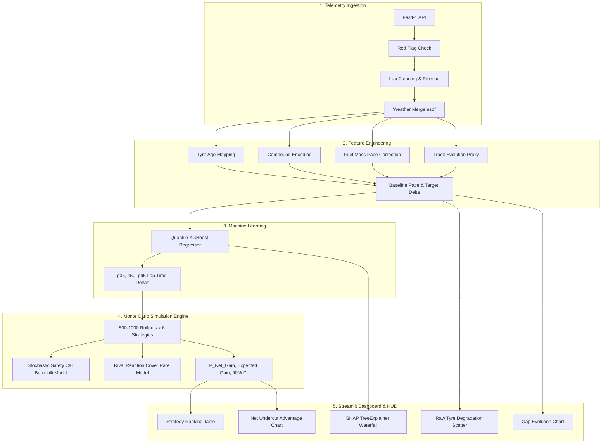
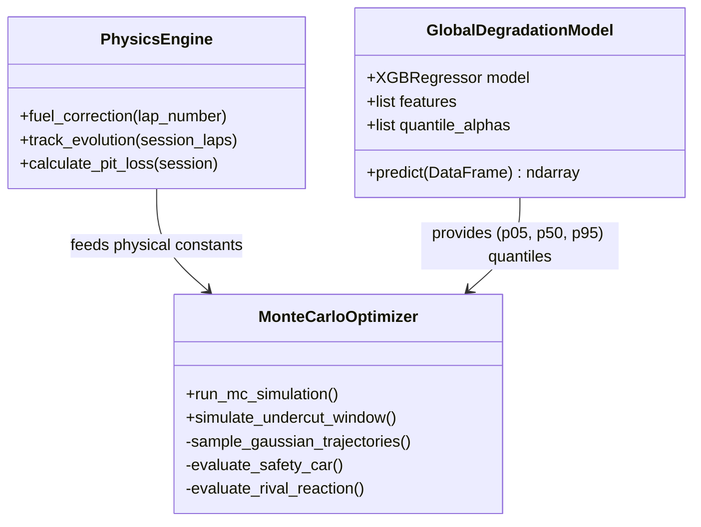

# COMPLETE REVERSE ENGINEERING, ARCHITECTURE & TECHNICAL SPECIFICATION
# Formula 1 Strategy Engineer: Uncertainty-Aware Monte Carlo Pit Strategy Optimization Platform

> **Document Type:** Central Source of Truth (PRD & System Reverse Engineering Specification)  
> **Target Audience:** Principal Software Architects, Senior Quantitative Engineers, Machine Learning Researchers, and Autonomous LLM Evaluators  
> **Repository Root:** `C:\f1`  
> **Active Branch:** `vedaanth-dev`  
> **Current Version:** Phase 2 (Uncertainty-Aware Quantile XGBoost & Monte Carlo Optimization Engine)  
> **Generated:** March 2025 / Complete Repository Reverse Engineering  

---

## TABLE OF CONTENTS
1. [Phase 1 — Complete Repository Discovery](#phase-1--complete-repository-discovery)
2. [Phase 2 — Project Purpose and Problem Statement](#phase-2--project-purpose-and-problem-statement)
3. [Phase 3 — Complete Feature Breakdown](#phase-3--complete-feature-breakdown)
4. [Phase 4 — End-to-End System Workflows](#phase-4--end-to-end-system-workflows)
5. [Phase 5 — System Architecture Deep Dive](#phase-5--system-architecture-deep-dive)
6. [Phase 6 — Data Architecture & Schema Analysis](#phase-6--data-architecture--schema-analysis)
7. [Phase 7 — Core Logic, Mathematical Models & Algorithms](#phase-7--core-logic-mathematical-models--algorithms)
8. [Phase 8 — API & Interface Documentation](#phase-8--api--interface-documentation)
9. [Phase 9 — Security, Reliability & Failure Modes](#phase-9--security-reliability--failure-modes)
10. [Phase 10 — Frontend UI & User Experience Engineering](#phase-10--frontend-ui--user-experience-engineering)
11. [Phase 11 — Backend Execution & Data Pipelines](#phase-11--backend-execution--data-pipelines)
12. [Phase 12 — Current Implementation & Verification Status](#phase-12--current-implementation--verification-status)
13. [Phase 13 — Architectural Trade-Offs & Design Rationale](#phase-13--architectural-trade-offs--design-rationale)
14. [Phase 14 — Complete Technical Reference & Glossary](#phase-14--complete-technical-reference--glossary)
15. [Phase 15 — Independent LLM Project Context Brief](#phase-15--independent-llm-project-context-brief)

---

# PHASE 1 — COMPLETE REPOSITORY DISCOVERY

### 1.1 Project Root Structure
The repository is located at `C:\f1`. It contains a hybrid data science, machine learning, and interactive web dashboard stack written in Python, operating on real-world Formula 1 telemetry from the 2022–2025 "Ground Effect" aerodynamic regulatory era.

```text
C:\f1\
├── .gitignore                          # Version control exclusions (data/, models/, cache, bytecode)
├── app.py                              # Primary production web application entrypoint (Streamlit)
├── current_prd.md                      # Phase 2 high-level PRD document
├── data_collector.py                   # Offline batch historical telemetry ingestion script
├── data_pipeline.py                    # Telemetry cleaning, flag validation, and weather merging
├── explain_change.md                   # Plain-English architectural evolution guide
├── f1_project_guide.md                 # Interview architecture and technical learning guide
├── feature_engineering.py              # Physics-based feature derivation (fuel mass, track evolution)
├── figure4_undercut.png                # Pre-rendered export of net undercut advantage curve
├── generate_figure.py                  # Standalone matplotlib script generating figure4_undercut.png
├── latest_explanation.md               # Intermediate technical explanation document
├── ml_model.py                         # Legacy Phase 1 Random Forest and baseline pace preparation
├── new_changes.md                      # Curated Phase 2 research paper roadmap & feature plan
├── phase2_analysis.md                  # Detailed code audit of Phase 2 vs baseline implementation
├── projectprd.md                       # Initial Phase 1 draft PRD (Random Forest baseline)
├── requirements.txt                    # Project dependencies (Streamlit, FastF1, Plotly, XGBoost, etc.)
├── simulation.py                       # Phase 2 Monte Carlo strategy optimizer & undercut engine
├── tempCodeRunnerFile.py               # Transient editor artifact (empty)
├── test_metadata.py                    # Pytest suite validating metadata and asset resolution
├── test_pit_stop.py                    # Ad-hoc experimental script for pit-loss calculations
├── train_global_model.py               # Offline GPU/CPU training pipeline for quantile XGBoost
├── ui_app.py                           # Standalone multi-page UI shell prototype (decoupled)
├── assets/
│   ├── README.md                       # Asset directory documentation and ingestion rules
│   ├── cars/                           # Team car livery imagery (Alpine.jpg, Ferrari.jpg, etc.)
│   ├── drivers/                        # Driver headshot portraits (VER.jpg, HAM.jpg, NOR.jpg, etc.)
│   ├── home/                           # Cinematic hero background assets (new_hero_bg.png, etc.)
│   └── tracks/                         # Track circuit diagrams (directory allocated)
├── data/
│   ├── cars.json                       # Car model specifications and livery mapping
│   ├── drivers.json                    # Driver numbers, teams, codes, and photo links
│   ├── historical_laps.csv             # 73,552 cleaned, feature-engineered laps across 2022-2025
│   ├── teams.json                      # Team branding, hex accent colors, and headquarters
│   └── tracks.json                     # Track lengths, lap counts, names, and strategic traits
├── docs/
│   └── ui_iteration_notes.md           # UI design evolution notes and asset intake constraints
├── f1_cache/                           # FastF1 serialized telemetry cache (.ff1pkl files)
├── models/
│   └── global_degradation_model.joblib # Serialized multi-output quantile XGBoost model (13.5 MB)
└── ui/
    ├── __init__.py                     # UI package marker
    ├── assets.py                       # Base64 data URI encoder and path resolution
    ├── charts.py                       # Dark motorsport Plotly styling layout
    ├── components.py                   # Reusable HTML/CSS panels, hero banners, and stat grids
    ├── homepage.py                     # Cinematic HUD matchup cards, theme injection, and event strip
    ├── metadata.py                     # LRU-cached JSON metadata loaders and asset lookup engine
    ├── theme.py                        # Color constants, team color definitions, and shared CSS
    └── pages/
        ├── __init__.py                 # Subpage package marker
        ├── asset_library.py            # Missing asset auditor and metadata table viewer
        ├── driver_comparison.py        # Driver vs driver preview card prototype
        ├── home.py                     # Decoupled homepage prototype
        ├── race_setup.py               # Decoupled race setup prototype
        ├── strategy_analysis.py        # Decoupled strategy analysis placeholder
        └── track_profile.py            # Decoupled circuit profile prototype
```

---

### 1.2 File-by-File Technical Inventory

| File Path | Functional Role | Execution Context | Key Dependencies | Primary Functions / Symbols |
|---|---|---|---|---|
| `app.py` | Main Application Dashboard | Interactive Streamlit Server (`streamlit run app.py`) | `streamlit`, `fastf1`, `pandas`, `plotly`, `shap`, `joblib` | `get_schedule()`, `load_race_data()`, `load_global_model()`, `process_backend_pipeline()`, `render_strategy_dashboard()` |
| `simulation.py` | Monte Carlo & Undercut Engine | Imported by `app.py` / Standalone CLI test | `numpy`, `pandas`, `fastf1` | `run_mc_simulation()`, `simulate_undercut_window()`, `calculate_pit_loss()`, `_predict_quantiles()`, `_build_feature_batch()` |
| `train_global_model.py` | Model Training Pipeline | Offline CLI Execution (`python train_global_model.py`) | `xgboost`, `pandas`, `numpy`, `sklearn`, `joblib` | `train_global()` |
| `data_pipeline.py` | Telemetry Ingestion & Sanitization | Imported by `app.py`, `data_collector.py` | `fastf1`, `pandas`, `os` | `load_race_session()`, `is_red_flag_race()`, `clean_lap_data()`, `merge_weather_data()` |
| `feature_engineering.py` | Physical Feature Derivation | Imported by pipelines & collector | `pandas`, `numpy` | `apply_feature_engineering()` |
| `ml_model.py` | Baseline Pace & Target Definition | Imported by pipelines & collector | `sklearn`, `pandas`, `numpy` | `prepare_ml_data()`, `train_degradation_model()`, `predict_future_laps()` |
| `data_collector.py` | Historical Dataset Generator | Offline Batch Script (`python data_collector.py`) | `fastf1`, `pandas`, `os` | `collect_season_data()` |
| `generate_figure.py` | Visual Paper Export | Offline Matplotlib Script | `matplotlib`, `numpy` | Plot generator for `figure4_undercut.png` |
| `test_metadata.py` | Unit Test Suite | Pytest Test Runner (`pytest`) | `pytest`, `ui.metadata` | `test_driver_lookup_by_fastf1_code()`, `test_asset_resolution_rejects_project_escape()` |
| `test_pit_stop.py` | Pit Loss Calculation Scratchpad | Ad-hoc CLI debugging | `fastf1`, `pandas` | Interactive exploration of `session.laps` pit timestamps |
| `ui_app.py` | Modular Multi-Page UI Shell | Alternative Streamlit Entrypoint (`streamlit run ui_app.py`) | `streamlit`, `ui.*` | Modular multi-page router |
| `ui/metadata.py` | Metadata & Asset Resolution Service | Imported across UI layer & test suite | `json`, `pathlib`, `functools.lru_cache` | `driver_profile()`, `get_driver()`, `get_track()`, `resolve_asset()`, `missing_assets()` |
| `ui/homepage.py` | Cinematic HUD & Theme Injector | Imported by `app.py` | `streamlit`, `ui.assets`, `ui.metadata` | `apply_homepage_theme()`, `render_homepage_hero()`, `render_matchup_preview()`, `render_event_strip()` |
| `ui/charts.py` | Dark Motorsport Chart Formatter | Imported by `app.py` | `plotly.graph_objects` | `style_chart()`, `DARK_CHART_LAYOUT` |
| `ui/components.py` | Reusable HTML/CSS UI Widgets | Imported by `ui_app.py` & UI modules | `streamlit`, `html`, `ui.theme` | `hero()`, `panel()`, `stat_grid()`, `state_message()`, `navigation()` |
| `ui/assets.py` | Asset Encoding & In-Memory Cache | Imported by `ui/homepage.py` | `base64`, `pathlib`, `functools.lru_cache` | `image_data_uri()`, `asset_path()` |
| `ui/theme.py` | UI Theme Constants & Global CSS | Imported across UI modules | Standard Python | `COLORS`, `TEAM_COLORS`, `CHART_LAYOUT`, `css()` |

---

### 1.3 Configuration Files and Environment Variables
- **Configuration Files:**
  - `requirements.txt`: Defines direct dependencies (`streamlit`, `fastf1`, `pandas`, `plotly`, `scikit-learn`, `numpy`). Note: `xgboost`, `shap`, and `joblib` are actively imported and required in code.
  - `.gitignore`: Prevents check-in of cache folders (`f1_cache/`), compiled python (`__pycache__/`, `*.pyc`), environment configurations (`.env`), datasets (`data/`), and serialized models (`models/`).
- **Environment Variables & Secrets:**
  - No secret keys (passwords, tokens, database credentials) are hardcoded or present in `.env`.
  - The FastF1 library interacts with the public Formula 1 timing feed and Ergast API mirrors without requiring mandatory authentication.
  - Optional Phase 1 stretch goal for the Claude API (Anthropic API Key) was outlined in `projectprd.md` but is **unimplemented in code**.

---

# PHASE 2 — PROJECT PURPOSE AND PROBLEM STATEMENT

### 2.1 The Fundamental Problem
In modern Formula 1 racing, strategic outcomes are overwhelmingly dictated by **tyre degradation dynamics** and **track position**. As tyres complete consecutive laps, the vulcanized rubber compounds suffer thermal degradation, mechanical wear, surface graining, and blistering. This results in progressive lap time slowdown, often culminating in an abrupt non-linear drop-off known as "falling off the tyre cliff."

A chasing driver stuck behind a slower car faces "dirty air" (turbulent wake), which reduces aerodynamic downforce, causes car sliding, increases tyre temperatures, and accelerates degradation. Overtaking on track is frequently impossible. 

The primary tactical weapon to overcome this is the **Undercut**:
1. The chasing car pits *first* for fresh, grippy tyres.
2. The leading car stays out on old, degrading tyres.
3. The newly pitted car exits into clean air and unleashes immediate, fresh-tyre pace (often 1.5 to 3.0 seconds per lap faster).
4. When the leading car pits one or two laps later, the time lost on old tyres allows the chasing car to pass them while they are traversing the pit lane.

```
       LAP N: Chaser pits for fresh tyres ───► Incurs ~24s pit lane loss
       LAP N+1: Chaser drives on fresh rubber  (Pace: 1:32.0)
                Leader stays out on dead rubber (Pace: 1:35.5)  ──► Delta = -3.5s
       LAP N+2: Leader enters pits ───► Incurs ~24s pit lane loss
       RESULT: Chaser emerges ahead on track! (Undercut Complete)
```

### 2.2 Why This Problem Exists
Human race engineers cannot accurately predict this crossover point through simple intuition because lap times are governed by multiple simultaneous non-linear variables:
1. **Fuel Burnoff Effect:** An F1 car starts with ~110 kg of fuel and burns ~1.7 kg per lap. As the car gets lighter, it naturally gains ~0.03 seconds per lap in lap time. This natural speed increase completely masks tyre degradation in raw telemetry!
2. **Track Evolution (Rubbering-In):** As 20 cars circulate, they lay down molten rubber along the racing line, increasing grip and making the track faster over time.
3. **Compound Non-Linearity:** Soft, Medium, and Hard compounds have vastly different thermal degradation curves and cliff thresholds.
4. **Stochastic Events:** Safety Cars (SC) and Virtual Safety Cars (VSC) collapse the effective time loss of a pit stop from ~24–26 seconds down to ~8–9 seconds because cars on track are restricted by a speed delta.
5. **Competitor Counter-Tactics:** If an undercut attempt is launched, the rival team may immediately "cover" by pitting on the very next lap.

### 2.3 Intended Target Audience
- **Motorsport Strategy Engineers & Pit Wall Analysts:** Professionals requiring quantitative decision-support models to identify pit windows before rivals exploit them.
- **Data Scientists & Quantitative Researchers:** Researchers evaluating probabilistic regression, survival/quantile modeling, and Monte Carlo optimization under stochastic constraints.
- **Technical Interview Evaluators & Academic Committees:** The codebase was developed and expanded as a portfolio and dissertation project demonstrating real-world data engineering, physics-grounded ML, and explainable AI.

---

# PHASE 3 — COMPLETE FEATURE BREAKDOWN

Below is the verified inventory of every feature implemented in the application codebase.



---

### Feature 3.1: Session Ingestion & Red Flag Guard
- **Description:** Dynamically fetches F1 season schedules and loads detailed session telemetry (laps, telemetry, weather, track status). Detects red flags and enforces PRD data integrity.
- **Implementation:** [`data_pipeline.py`](file:///C:/f1/data_pipeline.py#L9-L25), [`app.py`](file:///C:/f1/app.py#L30-L43).
- **Functions:** `get_schedule(year)`, `load_race_data(year, race_name)`, `is_red_flag_race(session)`.
- **Logic:** FastF1 `track_status` is inspected. TrackStatus `'5'` indicates a session stoppage (Red Flag). If present, the pipeline aborts processing with: `"Error: Race contains a Red Flag. Filtered out per PRD constraints to maintain valid degradation curves."` Red flags mandate tyre changes and restart gaps, destroying stint continuity.
- **Status:** **Fully Implemented and Verified.**

### Feature 3.2: Telemetry Data Cleaning & Weather Alignment
- **Description:** Filters noise and anomalies from raw lap data and attaches high-resolution weather readings.
- **Implementation:** [`data_pipeline.py`](file:///C:/f1/data_pipeline.py#L26-L66).
- **Functions:** `clean_lap_data(laps)`, `merge_weather_data(laps, weather)`.
- **Filtering Rules:**
  1. In-laps and out-laps are dropped via `pd.isnull(df['PitInTime']) & pd.isnull(df['PitOutTime'])` (pit lane transit speeds corrupt race pace).
  2. Safety Car, VSC, and yellow flag laps are filtered out using `df['TrackStatus'] == '1'` (only 100% green flag racing laps are retained).
  3. `LapTime` (timedelta) is converted to floating-point seconds (`LapTime_s`).
  4. `pd.merge_asof(laps, weather, on='Time', direction='backward')` attaches track surface temperature (`TrackTemp`) from the most recent weather broadcast prior to lap completion.
- **Status:** **Fully Implemented and Verified.**

### Feature 3.3: Physics-Grounded Feature Engineering
- **Description:** Normalizes lap times for physical dynamics that obscure true rubber degradation.
- **Implementation:** [`feature_engineering.py`](file:///C:/f1/feature_engineering.py#L4-L54).
- **Function:** `apply_feature_engineering(df)`.
- **Derived Metrics:**
  - `tyre_age`: Mapped directly from FastF1 `TyreLife` (integer consecutive laps on tyre set).
  - `compound_encoded`: Numeric categorical mapping (`SOFT`=1, `MEDIUM`=2, `HARD`=3).
  - `fuel_corrected_time`: Compensates for the lightening car using:
    $$\text{FuelMass} = 110.0 - (1.7 \times \text{LapNumber})$$
    $$\text{FuelCorrection} = \text{FuelMass} \times 0.03\text{ s/kg}$$
    $$\text{fuel\_corrected\_time} = \text{LapTime\_s} - \text{FuelCorrection}$$
  - `track_evolution`: Captures track rubbering-in by computing the session-wide median lap time per lap:
    $$\text{track\_evolution}(L) = \operatorname{median}_{d \in \text{Drivers}}(\text{LapTime\_s}_{d, L})$$
- **Status:** **Fully Implemented and Verified.**

### Feature 3.4: Stint Baseline Isolation & Target Variable Generation
- **Description:** Prepares the regression target by isolating pure tyre degradation from car/driver inherent pace.
- **Implementation:** [`ml_model.py`](file:///C:/f1/ml_model.py#L6-L32).
- **Function:** `prepare_ml_data(df)`.
- **Logic:** Identifies the minimum `tyre_age` lap for each driver's individual stint (the fresh tyre baseline):
  $$\text{baseline\_pace} = \text{fuel\_corrected\_time at } \min(\text{tyre\_age})_{\text{driver, stint}}$$
  $$\text{lap\_time\_delta} = \text{fuel\_corrected\_time} - \text{baseline\_pace}$$
- **Significance:** By predicting `lap_time_delta` (seconds lost relative to fresh rubber) rather than absolute lap time, the model normalizes for car performance differences (e.g., Red Bull vs. Haas) and generalizes across the entire grid.
- **Status:** **Fully Implemented and Verified.**

### Feature 3.5: Empirical Pit Loss Delta Calculation
- **Description:** Calculates circuit-specific pit lane transit and stop time loss dynamically from real session timestamps.
- **Implementation:** [`simulation.py`](file:///C:/f1/simulation.py#L385-L406).
- **Function:** `calculate_pit_loss(session)`.
- **Algorithm:** Filters laps with `PitInTime` (Stint $N$) and merges them with matching driver laps having `PitOutTime` (Stint $N+1$). Computes:
  $$\text{PitLaneTime} = \text{PitOutTime} - \text{PitInTime}$$
  Returns $\operatorname{median}(\text{PitLaneTime})$. Typically ranges between 21.0s and 27.5s depending on circuit pit-lane speed limits (60 km/h at Monaco, 80 km/h elsewhere) and pit lane length.
- **Status:** **Fully Implemented and Verified.**

### Feature 3.6: Probabilistic Quantile XGBoost Model
- **Description:** Gradient-boosted regression tree model trained on 73,552 historical laps to output non-crossing quantile predictions ($p_{05}, p_{50}, p_{95}$) of tyre wear.
- **Implementation:** [`train_global_model.py`](file:///C:/f1/train_global_model.py#L9-L111), [`models/global_degradation_model.joblib`](file:///C:/f1/models/global_degradation_model.joblib).
- **Hyperparameters:** `n_estimators=300`, `max_depth=8`, `learning_rate=0.05`, `tree_method='hist'`, `objective='reg:quantileerror'`, `quantile_alpha=[0.05, 0.50, 0.95]`, `enable_categorical=True`.
- **Inputs:** `['tyre_age', 'compound_encoded', 'baseline_pace', 'track_evolution', 'TrackTemp', 'Track', 'Driver']`.
- **Outputs:** Shape $(N, 3)$ representing pessimistic ($p_{95}$ degradation), median ($p_{50}$ expected), and optimistic ($p_{05}$ minimal wear) deltas.
- **Evaluation:** Evaluated via asymmetric Pinball Loss per quantile and verified for 90% empirical interval coverage on test sets.
- **Status:** **Fully Implemented and Verified.**

### Feature 3.7: Multi-Strategy Monte Carlo Optimizer
- **Description:** Simulates 6 candidate tactical strategies across a 15-lap forward horizon using stochastic sampling.
- **Implementation:** [`simulation.py`](file:///C:/f1/simulation.py#L113-L309).
- **Function:** `run_mc_simulation(...)`.
- **Candidate Strategies:**
  1. `Stay Out` (Baseline: current tyres continue to age)
  2. `Pit → Soft` (Pit on current lap, fit Softs)
  3. `Pit → Medium` (Pit on current lap, fit Mediums)
  4. `Pit → Hard` (Pit on current lap, fit Hards)
  5. `Pit+1 → Medium` (Stay out 1 more lap, then pit for Mediums)
  6. `Pit+1 → Hard` (Stay out 1 more lap, then pit for Hards)
- **Sampling Logic:** Draws $N=500$ (or 1,000) trajectories per strategy by sampling from Gaussian approximations bounded by the predicted quantiles:
  $$\sigma \approx \frac{p_{95} - p_{05}}{2 \times 1.645}$$
  $$\Delta_{\text{sample}} \sim \mathcal{N}(p_{50}, \sigma^2)$$
- **Status:** **Fully Implemented and Verified.**

### Feature 3.8: Stochastic Safety Car & VSC Injection
- **Description:** Models sudden race neutralization events during pit windows.
- **Implementation:** [`simulation.py`](file:///C:/f1/simulation.py#L22-L54, #L233-L241).
- **Constants:** `SC_RATES` lookup dictionary mapping 24 Grand Prix circuits to empirical per-lap SC probabilities (e.g., Monaco: 0.14, Azerbaijan: 0.14, Singapore: 0.12, Monza: 0.04, Bahrain: 0.04).
- **Mechanic:** For each rollout, draws a Bernoulli trial `rng.binomial(1, sc_rate)`. If triggered on the pit lap, pit lane loss collapses by 65%:
  $$\text{EffectivePitLoss} = \text{PitLossDelta} \times 0.35$$
  (Reflecting that cars on track travel under the VSC/SC delta, saving ~15–17 seconds during a pit stop).
- **Status:** **Fully Implemented and Verified.**

### Feature 3.9: Competitor Reaction & Cover Rate Modeling
- **Description:** Models defensive competitor reactions (two-agent interaction) when an undercut is attempted.
- **Implementation:** [`simulation.py`](file:///C:/f1/simulation.py#L160-L168, #L246-L261).
- **Calibration Table:**
  - $|\text{Gap}| \le 1.5\text{s} \implies P(\text{Cover}) = 0.75$
  - $1.5\text{s} < |\text{Gap}| \le 3.0\text{s} \implies P(\text{Cover}) = 0.45$
  - $3.0\text{s} < |\text{Gap}| \le 5.0\text{s} \implies P(\text{Cover}) = 0.20$
  - $|\text{Gap}| > 5.0\text{s} \implies P(\text{Cover}) = 0.05$
- **Simulation Impact:** If the rival covers on lap $\text{pit\_offset} + 1$, both drivers receive fresh tyre pace, clamping Driver A's cumulative advantage to whatever was gained on that single undercut lap.
- **Status:** **Fully Implemented and Verified.**

### Feature 3.10: Adaptive Decision Rule
- **Description:** Replaced Phase 1's fixed arbitrary heuristic (`net_undercut_advantage[2] >= 1.5s`) with a probabilistic risk-adjusted decision engine.
- **Implementation:** [`simulation.py`](file:///C:/f1/simulation.py#L283-L285).
- **Rule:** A pit window is declared `OPEN` if and only if:
  $$P(\text{Net Gain} > 0) \ge 0.55 \quad \land \quad \mathbb{E}[\text{Net Gain}] > 0.00\text{s}$$
  The UI formats probabilities: Green ($\ge 65\%$), Amber ($50\%–64\%$), Red ($< 50\%$).
- **Status:** **Fully Implemented and Verified.**

### Feature 3.11: Model Explainability via SHAP
- **Description:** Computes feature contributions for any simulated lap to explain *why* the model predicts degradation or pace advantage.
- **Implementation:** [`app.py`](file:///C:/f1/app.py#L553-L627).
- **Engine:** Uses `shap.TreeExplainer(model)` on the multi-quantile XGBoost model. Extracts $p_{50}$ explanation slice (`shap_values[0, :, 1]` or `shap_values[0]`).
- **Visual:** Horizontal bar chart color-coding positive SHAP values in red (features slowing the car down, e.g., high tyre age) and negative SHAP values in green (features accelerating the car, e.g., fresh compound or rubbered-in track).
- **Status:** **Fully Implemented and Verified.**

### Feature 3.12: Cinematic HUD & Local Metadata System
- **Description:** Bespoke dark motorsport UI styling inspired by modern racing telecasts, featuring local driver portraits, car liveries, team hex colors, and SVG track profiles.
- **Implementation:** [`ui/metadata.py`](file:///C:/f1/ui/metadata.py), [`ui/homepage.py`](file:///C:/f1/ui/homepage.py), [`ui/theme.py`](file:///C:/f1/ui/theme.py), [`ui/charts.py`](file:///C:/f1/ui/charts.py).
- **Asset Security:** Local filesystem path traversal protection (`resolve_asset` checks `candidate.relative_to(PROJECT_ROOT)`). No internet image fetching is permitted.
- **Status:** **Fully Implemented and Verified.**

---

# PHASE 4 — END-TO-END SYSTEM WORKFLOWS

### 4.1 Application Startup Lifecycle

```
[STREAMLIT EXECUTION ENGINE]
   │
   ├─► 1. st.set_page_config(layout="wide")
   ├─► 2. fastf1.Cache.enable_cache("f1_cache")
   ├─► 3. apply_homepage_theme() ──► Injects custom CSS & background grid
   ├─► 4. render_homepage_hero() ──► Draws cinematic title & kicker
   ├─► 5. get_schedule(2023) ─────► Retrieves calendar via FastF1 (Cached)
   ├─► 6. render_race_setup() ────► Renders synchronized Sidebar & Main panel dropdowns
   └─► 7. Awaiting User Interaction ("Load Race Strategy Data")
```

---

### 4.2 Comprehensive Workflow Execution Trace: Race Strategy Analysis

Below is the step-by-step trace of what happens when a user loads a Grand Prix and runs the Monte Carlo optimizer:

```
USER ACTION: User selects Season=2024, Grand Prix="Bahrain Grand Prix" -> Clicks "Load Race Strategy Data"
   │
   ▼
FRONTEND EVENT: Streamlit Button Callback
   │  - Function: load_requested_race(year, race_name) in app.py:92
   │  - State Update: st.session_state["year"] = 2024, st.session_state["race"] = "Bahrain Grand Prix"
   │  - Trigger: Streamlit reruns script from top
   │
   ▼
BACKEND PROCESSING: Data Loading & Cache Check
   │  - Function: load_race_data(2024, "Bahrain Grand Prix") in app.py:39
   │  - Execution: fastf1.get_session(2024, "Bahrain Grand Prix", "R").load(weather=True)
   │  - Storage: Checked against local f1_cache/. If present, loads .ff1pkl files.
   │
   ▼
BACKEND PROCESSING: Data Sanitization & Cleaning Pipeline
   │  - Function: process_backend_pipeline() in app.py:63
   │  - Step 1: is_red_flag_race(session) in data_pipeline.py:18
   │            Checks session.track_status for Status '5'. If found, halts with st.error.
   │  - Step 2: clean_lap_data(session.laps) in data_pipeline.py:26
   │            Filters PitInTime / PitOutTime is null.
   │            Filters TrackStatus == '1'.
   │            Converts LapTime timedelta to LapTime_s float.
   │  - Step 3: merge_weather_data(clean_laps, session.weather_data) in data_pipeline.py:52
   │            Performs pd.merge_asof(direction='backward') on Time column to append TrackTemp.
   │
   ▼
BUSINESS LOGIC: Physics Feature Engineering & Baseline Preparation
   │  - Function: apply_feature_engineering(final_laps) in feature_engineering.py:4
   │            Computes fuel_mass = 110.0 - 1.7 * LapNumber
   │            Computes fuel_corrected_time = LapTime_s - (fuel_mass * 0.03)
   │            Computes track_evolution = median(LapTime_s per LapNumber)
   │            Maps compound_encoded: SOFT=1, MEDIUM=2, HARD=3
   │  - Function: prepare_ml_data(engineered_data) in ml_model.py:6
   │            Finds min(tyre_age) per (Driver, Stint) -> baseline_pace
   │            Computes target delta: lap_time_delta = fuel_corrected_time - baseline_pace
   │  - Function: calculate_pit_loss(session) in simulation.py:385
   │            Matches in-laps with out-laps (stint -> stint+1). Computes median PitLaneTime (~24.5s).
   │
   ▼
FRONTEND RENDER: Matchup & Visual Analytics Display
   │  - Function: render_event_strip() & render_matchup_preview() in ui/homepage.py:385
   │            Fetches driver metadata, national flags, team colors from data/*.json.
   │            Renders Driver A (VER) vs Driver B (LEC) HUD Cards.
   │  - Chart 1: Tyre Degradation Scatter Plot (px.scatter)
   │            Plots LapNumber vs LapTime_s, Y-axis reversed (faster is higher).
   │  - Chart 2: Gap Evolution Line Chart (go.Figure)
   │            Merges Time_A and Time_B by LapNumber. Computes Gap_Seconds = Time_A - Time_B.
   │
   ▼
USER ACTION: User adjusts "Simulate from Lap" (e.g. Lap 14), selects "MC Rollouts" (500), and inspects optimizer
   │
   ▼
BUSINESS LOGIC: Probabilistic Quantile Inference & Monte Carlo Simulation
   │  - Function: run_mc_simulation() in simulation.py:113
   │  - Step 1: Extracts current_state for Driver A at Lap 14:
   │            {tyre_age: 14, compound: SOFT, baseline_pace: 95.82s, Track: "Bahrain", Driver: "VER"}
   │  - Step 2: Extracts 15-lap forward track environment (track_evolution, TrackTemp).
   │  - Step 3: Builds Stay-Out batch DataFrame -> model.predict() -> returns (15, 3) quantiles (p05, p50, p95).
   │            Estimates std = (p95 - p05) / (2 * 1.645).
   │            Samples 500 Stay-Out trajectories: baseline_pace + delta_sample + fuel_correction.
   │  - Step 4: Loops through 5 pit strategies (Pit->S, Pit->M, Pit->H, Pit+1->M, Pit+1->H).
   │            Resets tyre_age to 1 on pit lap.
   │            Evaluates model.predict() -> samples 500 trajectories.
   │            Samples Safety Car Bernoulli events using SC_RATES["Bahrain Grand Prix"] (0.04).
   │            If SC=True, collapses pit loss: pit_loss_delta * 0.35.
   │            Computes rival cover probability from current gap (cover_rate = 0.45).
   │            If rival covers, clamps advantage after reaction lap (pit_offset + 1).
   │  - Step 5: Computes P(Net Gain > 0), Expected Gain (s), and 90% Confidence Intervals [CI_low, CI_high].
   │            Evaluates decision rule: window_open = (p_net_gain >= 0.55) & (expected_gain > 0).
   │
   ▼
FRONTEND STATE UPDATE & SHAP EXPLAINABILITY
   │  - Renders HTML Strategy Matrix Table with color-coded confidence pills and CI spreads.
   │  - Chart 3: Net Undercut Advantage Plot (go.Figure) displaying cumulative seconds gained/lost.
   │  - Decision Banner: Emits green "UNDERCUT WINDOW OPEN" or amber/red status verdict.
   │  - SHAP TreeExplainer: Computes Shapley values for Lap 14 features -> renders horizontal bar chart.
```

---

# PHASE 5 — SYSTEM ARCHITECTURE DEEP DIVE

### 5.1 Architecture Overview
The application follows a **Decoupled Modular Architecture** featuring offline batch training, dynamic on-demand feature engineering, and an in-memory Monte Carlo optimization engine bound to an interactive presentation layer.

```mermaid
graph TB
    subgraph DATA_PERSISTENCE["Data & Storage Layer"]
        FF1_API["FastF1 Telemetry Feed"]
        CACHE["Local Disk Cache (f1_cache/*.ff1pkl)"]
        CSV["Historical Dataset (data/historical_laps.csv)"]
        JSON["Metadata Stores (data/*.json)"]
        JOB["Serialized Model (models/global_degradation_model.joblib)"]
    end

    subgraph OFFLINE_PIPELINE["Offline Training Pipeline"]
        DC["data_collector.py"]
        TRAIN["train_global_model.py"]
        DC -->|Ingests 73k Laps| CSV
        CSV -->|GPU Training (reg:quantileerror)| TRAIN
        TRAIN -->|Dumps Model Dict| JOB
    end

    subgraph ENGINE_LAYER["Core Computational Engines"]
        DP["data_pipeline.py\n(Cleaning, Red Flag, Weather)"]
        FE["feature_engineering.py\n(Fuel mass, Track evolution)"]
        ML["ml_model.py\n(Baseline Pace, Delta target)"]
        SIM["simulation.py\n(Monte Carlo, SC, Rival Reaction)"]
    end

    subgraph PRESENTATION_LAYER["Presentation & UI Layer (Streamlit)"]
        APP["app.py (Main Application Entry)"]
        UI_HOME["ui/homepage.py (Cinematic HUD & CSS)"]
        UI_META["ui/metadata.py (LRU Cache Asset Resolver)"]
        UI_CHART["ui/charts.py (Plotly Styling Engine)"]
        SHAP_MOD["SHAP TreeExplainer (Explainability)"]
    end

    FF1_API --> CACHE
    CACHE --> DP
    DP --> FE --> ML --> APP
    JOB -->|Loaded at startup| APP
    JSON --> UI_META --> UI_HOME --> APP
    APP --> SIM
    SIM --> APP
    APP --> UI_CHART
    APP --> SHAP_MOD
```

---

### 5.2 Architectural Layer Responsibilities

#### 1. Ingestion & Preprocessing Layer (`data_pipeline.py`)
- Interfaces directly with `fastf1.get_session()` and enforces disk memoization via `f1_cache/`.
- Validates session safety flag integrity: checks `session.track_status` for red flag events (`'5'`) and rejects corrupted sessions.
- Strips non-racing laps: discards laps with non-null `PitInTime` or `PitOutTime`, and filters `TrackStatus != '1'`.
- Synchronizes lap completion times with track surface weather telemetry via asynchronous nearest-prior joins (`pd.merge_asof(direction='backward')`).

#### 2. Physics & Feature Engineering Layer (`feature_engineering.py`, `ml_model.py`)
- Isolates vehicle fuel load mass reduction: subtracts a linear fuel burn rate of $1.7\text{ kg/lap}$ from a $110\text{ kg}$ starting load, multiplying by $0.03\text{ s/kg}$ to adjust lap time.
- Approximates circuit grip accretion ("rubber-in"): computes dynamic session medians per lap across all active competitors.
- Normalizes individual driver pace: calculates `baseline_pace` from the freshest tyre lap of each stint and sets the target variable as `lap_time_delta = fuel_corrected_time - baseline_pace`.

#### 3. Machine Learning & Uncertainty Layer (`train_global_model.py`, `models/`)
- Replaces point-estimate predictions with an offline-trained, GPU-accelerated **XGBoost Quantile Regressor** (`reg:quantileerror`).
- Models non-linear tyre cliff degradation across 25 circuits and 35 drivers without requiring manual one-hot encoding by leveraging native categorical support (`enable_categorical=True`).
- Simultaneously outputs three quantiles ($p_{05}, p_{50}, p_{95}$) per lap, guaranteeing non-crossing monotonicity ($p_{05} \le p_{50} \le p_{95}$).

#### 4. Simulation & Optimization Engine (`simulation.py`)
- Executes forward 15-lap Monte Carlo rollouts across 6 candidate pit strategies.
- Converts quantile boundaries into continuous rollout distributions using Gaussian approximations.
- Injects circuit-specific empirical Safety Car probabilities via Bernoulli trials, realistically collapsing pit loss by 65%.
- Implements two-agent defensive game theory: models rival reaction probabilities based on on-track time gap brackets.
- Replaces fixed lap-time heuristics with an adaptive, probability-based decision engine ($P(\text{Net Gain}) \ge 55\%$).

#### 5. Presentation & UI Layer (`app.py`, `ui/`)
- Streamlit web platform featuring dual synchronized configuration inputs (Sidebar and Main Hero).
- High-fidelity dark motorsport UI design (NFS Unbound-inspired aesthetic).
- LRU-cached asset resolution engine preventing directory escape vulnerabilities.
- Interactive Plotly visualizations (Tyre Degradation scatter, Gap Evolution line, Net Undercut Advantage curve).
- Real-time model explainability powered by SHAP tree interpretations.

---

# PHASE 6 — DATA ARCHITECTURE & SCHEMA ANALYSIS

The project does not employ a traditional relational SQL or NoSQL database server. Instead, it relies on a high-performance **File-Based Storage and Serialized Cache Architecture** optimized for rapid analytical reads.

### 6.1 The Historical Lap Dataset (`data/historical_laps.csv`)
- **Total Record Count:** 73,552 clean racing laps.
- **Seasons Covered:** 2022 (14,274 laps), 2023 (16,565 laps), 2024 (19,716 laps), 2025 (22,997 laps).
- **Unique Grand Prix Tracks:** 25 circuits.
- **File Size:** ~33.0 MB.

#### Data Schema & Column Specifications

| Column Name | Data Type | Physical / Analytical Meaning | Source / Derivation |
|---|---|---|---|
| `Time` | string (timedelta) | Elapsed session time at lap completion | FastF1 API |
| `Driver` | string (categorical) | Three-letter driver abbreviation (e.g., VER, HAM, LEC) | FastF1 API |
| `DriverNumber` | integer | Official racing car number (e.g., 1, 44, 16) | FastF1 API |
| `LapTime` | string (timedelta) | Raw lap time | FastF1 API |
| `LapNumber` | float / integer | Race lap number (1 to $N$) | FastF1 API |
| `Stint` | float / integer | Driver stint index within the race | FastF1 API |
| `PitOutTime` | string (timedelta) | Timestamp car exited pit lane (null for flying laps) | FastF1 API |
| `PitInTime` | string (timedelta) | Timestamp car entered pit lane (null for flying laps) | FastF1 API |
| `Sector1Time` | string (timedelta) | Time elapsed in track Sector 1 | FastF1 API |
| `Sector2Time` | string (timedelta) | Time elapsed in track Sector 2 | FastF1 API |
| `Sector3Time` | string (timedelta) | Time elapsed in track Sector 3 | FastF1 API |
| `SpeedI1` | float | Speed trap 1 velocity (km/h) | FastF1 Telemetry |
| `SpeedI2` | float | Speed trap 2 velocity (km/h) | FastF1 Telemetry |
| `SpeedFL` | float | Finish line velocity (km/h) | FastF1 Telemetry |
| `SpeedST` | float | Longest straight speed trap velocity (km/h) | FastF1 Telemetry |
| `Compound` | string | Tyre compound name (`SOFT`, `MEDIUM`, `HARD`) | Pirelli / FastF1 |
| `TyreLife` | float | Total laps completed on this physical tyre set | FastF1 API |
| `FreshTyre` | boolean | True if tyre had 0 laps prior to stint | FastF1 API |
| `Team` | string | Constructor team name (e.g., Red Bull Racing) | FastF1 API |
| `TrackStatus` | string | Track condition flag (`1` = Green Flag) | FIA Timing Feed |
| `Position` | float | Track running position at lap completion | FIA Timing Feed |
| `LapTime_s` | float | Lap time converted to total seconds | Calculated: `LapTime.dt.total_seconds()` |
| `AirTemp` | float | Ambient air temperature (°C) | Track Weather Station |
| `Humidity` | float | Relative air humidity percentage (%) | Track Weather Station |
| `Pressure` | float | Atmospheric air pressure (mbar) | Track Weather Station |
| `Rainfall` | boolean | Boolean precipitation sensor indicator | Track Weather Station |
| `TrackTemp` | float | Track tarmac surface temperature (°C) | Track IR Pyrometer Sensor |
| `WindDirection` | integer | Wind direction in degrees (0–360°) | Track Weather Station |
| `WindSpeed` | float | Wind velocity (m/s) | Track Weather Station |
| `tyre_age` | float | Machine learning feature: consecutive stint laps | Mapped from `TyreLife` |
| `compound_encoded` | float | Ordinal numeric tyre compound: 1=Soft, 2=Med, 3=Hard | Mapped from `Compound` |
| `fuel_corrected_time` | float | Lap time in seconds normalized for burned fuel | Calculated: `LapTime_s - (110 - 1.7*L)*0.03` |
| `track_evolution` | float | Circuit rubber-in grip proxy (session median pace) | Calculated: `median(LapTime_s per LapNumber)` |
| `baseline_pace` | float | Driver's fuel-corrected pace on fresh rubber | Calculated: `fuel_corrected_time at min(tyre_age)` |
| `lap_time_delta` | float | **Primary Regression Target**: tyre degradation in seconds | Calculated: `fuel_corrected_time - baseline_pace` |
| `Track` | string (categorical) | Official Grand Prix event name | Session Metadata |
| `Season` | integer | Championship calendar year (2022–2025) | Session Metadata |

---

### 6.2 FastF1 Disk Cache (`f1_cache/`)
FastF1 enforces an automatic local disk cache using Python `pickle` serialization. For every accessed session, it creates a folder hierarchy structured as:
`f1_cache/<YEAR>/<DATE>_<GRAND_PRIX>/<DATE>_<SESSION>/`

Inside this folder, it stores:
- `car_data.ff1pkl`: High-frequency vehicle telemetry (RPM, Speed, Throttle, Brake, Gear, DRS) sampled at ~10 Hz.
- `position_data.ff1pkl`: GPS coordinates $(X, Y, Z)$ of every car on track.
- `lap_data.ff1pkl`: Sector splits, pit flags, tyre life, and lap boundaries.
- `weather_data.ff1pkl`: 1-minute interval atmospheric and track surface readings.
- `track_status_data.ff1pkl`: Safety car, VSC, and yellow/red flag intervals.
- `timing_app_data.ff1pkl` & `_extended_timing_data.ff1pkl`: Official timing transponder logs.

---

### 6.3 Local Metadata Stores (`data/*.json`)
The application includes structured JSON configuration files that provide domain context and feed the UI asset engine:

1. **`data/drivers.json` (192 lines):**
   Contains entries for 21 active and historical drivers.
   ```json
   {
     "code": "VER",
     "name": "Max Verstappen",
     "number": 1,
     "team": "Red Bull Racing",
     "country": "Netherlands",
     "photo": "assets/drivers/VER.png",
     "carId": "red_bull_rb20"
   }
   ```
2. **`data/teams.json` (73 lines):**
   Contains 10 constructor profiles with hex accent and secondary colors:
   - Red Bull Racing: `#3671C6` / `#E10600`
   - Ferrari: `#E80020` / `#FFD166`
   - Mercedes: `#27F4D2` / `#C8CCCE`
   - McLaren: `#FF8000` / `#47C7FC`
   - Aston Martin: `#229971` / `#CEDC00`
   - Alpine: `#FF87BC` / `#0093CC`
   - Williams: `#64C4FF` / `#00247D`
   - RB: `#6692FF` / `#FFFFFF`
   - Kick Sauber: `#52E252` / `#08090B`
   - Haas: `#B6BABD` / `#E10600`
3. **`data/cars.json` (35 lines):**
   Maps vehicle IDs (`red_bull_rb20`, `ferrari_sf24`, `mercedes_w15`, `mclaren_mcl38`) to engine manufacturers and livery images.
4. **`data/tracks.json` (63 lines):**
   Maps official race names to FastF1 aliases, lap counts, circuit lengths (km), race distances, and strategic parameters (`tyreStress`, `overtakingDifficulty`, `pitLaneSensitivity`).

---

# PHASE 7 — CORE LOGIC, MATHEMATICAL MODELS & ALGORITHMS



---

### 7.1 Fuel Mass Pace Correction Algorithm
- **Location:** [`feature_engineering.py:35-37`](file:///C:/f1/feature_engineering.py#L35-L37)
- **Mathematical Formulation:**
  Formula 1 technical regulations cap maximum starting race fuel at $110\text{ kg}$. The average fuel consumption is approximately $1.7\text{ kg}$ per lap. Across all modern circuits, weight sensitivity benchmarks show that $10\text{ kg}$ of fuel mass penalty costs approximately $0.30\text{ s}$ per lap, yielding a sensitivity constant of $0.03\text{ s/kg}$.
  $$\text{FuelMass}(L) = 110.0 - (1.7 \times L)$$
  $$\text{Correction}(L) = \text{FuelMass}(L) \times 0.03$$
  $$\text{LapTime}_{\text{corrected}}(L) = \text{LapTime\_s}(L) - \text{Correction}(L)$$
- **Why It Is Essential:** Without this correction, the progressive lightening of the vehicle produces faster lap times that mask rubber degradation. An uncorrected model learns an inverted or flat wear curve.

---

### 7.2 Track Evolution Rubbering-In Proxy
- **Location:** [`feature_engineering.py:45-46`](file:///C:/f1/feature_engineering.py#L45-L46)
- **Mathematical Formulation:**
  As race cars deposit hot tyre rubber on the asphalt, micro-roughness increases, improving grip. This phenomenon is session-wide and non-linear. The algorithm isolates track evolution by taking the median fuel-corrected lap time across all active drivers for each lap number:
  $$\text{TrackEvolution}(L) = \operatorname{median}_{i \in \text{Drivers}}(\text{LapTime\_s}_{i, L})$$
- **Why It Is Essential:** If all cars on track gain $0.5\text{s}$ between Lap 20 and Lap 35, this pace improvement is driven by the circuit surface rather than tyre longevity. Feeding `track_evolution` into the regression model allows it to decouple track grip from tyre wear.

---

### 7.3 Probabilistic Quantile Pinball Loss Model
- **Location:** [`train_global_model.py:44-72`](file:///C:/f1/train_global_model.py#L44-L72)
- **Objective Function:** `objective='reg:quantileerror'`, with $\alpha \in [0.05, 0.50, 0.95]$.
- **Mathematical Formulation:**
  For a given quantile $\tau \in (0, 1)$, target $y$ (`lap_time_delta`), and prediction $\hat{y}_\tau$, the asymmetric pinball loss function $\mathcal{L}_\tau$ is defined as:
  $$\mathcal{L}_\tau(y, \hat{y}_\tau) = \begin{cases} \tau (y - \hat{y}_\tau) & \text{if } y \ge \hat{y}_\tau \\ (1 - \tau)(\hat{y}_\tau - y) & \text{if } y < \hat{y}_\tau \end{cases}$$
- **Model Output:** For every input row $\mathbf{x}$, the model outputs a three-dimensional vector:
  $$\hat{\mathbf{y}}(\mathbf{x}) = \begin{bmatrix} \hat{y}_{0.05}(\mathbf{x}) \\ \hat{y}_{0.50}(\mathbf{x}) \\ \hat{y}_{0.95}(\mathbf{x}) \end{bmatrix}$$
  where $\hat{y}_{0.05}$ is the optimistic degradation bound, $\hat{y}_{0.50}$ is the median expected degradation, and $\hat{y}_{0.95}$ is the pessimistic degradation bound. XGBoost $\ge 2.0$ guarantees non-crossing monotonic quantiles ($\hat{y}_{0.05} \le \hat{y}_{0.50} \le \hat{y}_{0.95}$).

---

### 7.4 Multi-Strategy Monte Carlo Simulation Algorithm
- **Location:** [`simulation.py:113-309`](file:///C:/f1/simulation.py#L113-L309)
- **Execution Horizon:** $H = 15\text{ laps}$.
- **Rollout Count:** $N = 500$ (configurable to 200 or 1,000).

```
FOR each strategy in [Stay Out, Pit->Soft, Pit->Medium, Pit->Hard, Pit+1->Medium, Pit+1->Hard]:
    1. Construct forward 15-lap tyre age vector:
       - If Stay Out: tyre_age[n] = current_tyre_age + n
       - If Pit Now:  tyre_age[n] = 1 + n
       - If Pit+1:    tyre_age[n] = current_tyre_age (for n=0), then 1 + (n - 1)
    
    2. Batch predict quantiles from XGBoost:
       (p05, p50, p95) = model.predict(batch_df)
    
    3. Approximate normal distribution standard deviation:
       sigma = max((p95 - p05) / (2 * 1.645), 1e-5)
    
    4. Sample N random trajectories:
       delta_samples = Normal(loc=p50, scale=sigma, size=(N, 15))
       lap_times = baseline_pace + delta_samples + fuel_corrections
    
    5. Sample Safety Car Bernoulli trials per rollout:
       sc_triggered = Bernoulli(p=SC_RATES[race_name], size=N)
       effective_pit_loss = where(sc_triggered, pit_loss * 0.35, pit_loss)
       lap_times[:, pit_offset] += effective_pit_loss
    
    6. Evaluate Rival Reaction:
       rival_reacts = Bernoulli(p=cover_rate, size=N)
       IF rival_reacts:
           clamp cumulative advantage after (pit_offset + 1)
    
    7. Compute net gains:
       net_gains = sum(stay_out_times, axis=1) - sum(pit_times, axis=1)
       p_net_gain = mean(net_gains > 0)
       expected_gain = mean(net_gains)
       gain_ci = [percentile(net_gains, 5), percentile(net_gains, 95)]
```

---

### 7.5 Crossover Lap Detection Algorithm
- **Location:** [`simulation.py:274-281`](file:///C:/f1/simulation.py#L274-L281)
- **Mathematical Definition:**
  The crossover lap is the exact lap $L^*$ where the per-lap pace on fresh rubber becomes strictly faster than remaining on degrading tyres:
  $$\Delta \text{Pace}(n) = \hat{y}_{p50, \text{pit}}(n) - \hat{y}_{p50, \text{stay\_out}}(n)$$
  $$L^* = \min \{ L_{\text{current}} + n \mid n \ge \text{pit\_offset} \land \Delta \text{Pace}(n) < 0 \}$$
  If $\Delta \text{Pace}(n) \ge 0$ for all $n \in [0, H-1]$, no crossover occurs within the 15-lap horizon, meaning the old tyres have not degraded sufficiently to justify pitting.

---

# PHASE 8 — API & INTERFACE DOCUMENTATION

### 8.1 Internal Python API Interfaces

#### `simulation.py::run_mc_simulation`
```python
def run_mc_simulation(
    model: xgb.XGBRegressor,
    current_lap: int,
    current_state: dict[str, Any],
    track_env: pd.DataFrame,
    pit_loss_delta: float,
    race_name: str = "",
    n_rollouts: int = 500,
    horizon: int = 15,
    feature_cols: list[str] | None = None,
    seed: int = 42,
    rival_gap_s: float | None = None,
) -> list[dict[str, Any]]:
```
- **Parameters:**
  - `model`: Trained multi-output XGBoost regression model.
  - `current_lap`: Integer race lap being analyzed (decision lap).
  - `current_state`: Dictionary containing `'tyre_age'`, `'compound_encoded'`, `'baseline_pace'`, `'Track'`, and `'Driver'`.
  - `track_env`: DataFrame indexed by `LapNumber` containing columns `['track_evolution', 'TrackTemp']`.
  - `pit_loss_delta`: Float median pit lane transit loss in seconds (e.g., `24.5`).
  - `race_name`: Grand Prix event string (used to query `SC_RATES`).
  - `n_rollouts`: Number of Monte Carlo iterations (default `500`).
  - `horizon`: Projection depth in laps (default `15`).
  - `rival_gap_s`: On-track time interval to competitor in seconds.
- **Returns:**
  A list of strategy dictionaries, sorted with `'Stay Out'` at index 0, followed by candidate pit strategies ranked by `expected_gain_s` in descending order:
  ```python
  {
      'name': 'Pit → Medium',
      'pit_offset': 0,
      'compound_encoded': 2,
      'p_net_gain': 0.724,              # 72.4% probability of beating Stay Out
      'expected_gain_s': 3.14,           # +3.14s expected advantage over 15 laps
      'gain_ci_low': -1.20,              # 5th percentile outcome
      'gain_ci_high': 7.45,              # 95th percentile outcome
      'crossover_lap': 16,               # Lap where fresh tyre pace exceeds old tyre
      'window_open': True,               # True if p_net_gain >= 0.55 and expected_gain > 0
      'sc_expected_gain_s': 18.22,       # Expected gain if a Safety Car occurs
      'cover_rate': 0.45,                # Rival defensive reaction probability
      'p50_lap_times': [96.2, 95.8, ...],# Array of 15 median lap times
  }
  ```

---

#### `data_pipeline.py::clean_lap_data`
```python
def clean_lap_data(laps: fastf1.core.Laps) -> pd.DataFrame:
```
- **Inputs:** FastF1 `Laps` DataFrame containing raw telemetry columns.
- **Outputs:** Sanitized `DataFrame` containing strictly green flag racing laps with added `LapTime_s`.
- **Error Conditions:** If no green laps exist (e.g., race halted immediately or incomplete fetch), returns an empty DataFrame.

---

#### `ui/metadata.py::driver_profile`
```python
@lru_cache(maxsize=32)
def driver_profile(code: str) -> dict[str, Any]:
```
- **Inputs:** Three-letter driver abbreviation (e.g., `"VER"`). Case-insensitive.
- **Outputs:** Merged profile dictionary containing driver metadata, team metadata, car metadata, verified local photo path, and verified local car livery path. Fallbacks to `"Unknown Team"` and monogram avatars if metadata is missing.

---

### 8.2 External Integrations & Data Feeds
1. **FastF1 Library (`fastf1`):**
   - **Role:** Official open-source wrapper for live and historical Formula 1 telemetry, timing feeds, and Ergast API mirrors.
   - **Protocol:** HTTP REST / static Ergast JSON endpoints.
   - **Caching:** Automatically serializes API payloads to `f1_cache/` to prevent redundant network requests and avoid API rate limits.
   - **Failure Modes:** Incomplete sessions, delayed timing feeds for brand new races, or session format changes (Sprint weekends vs. Standard weekends). Handled by filtering out non-Grand Prix testing formats via `EventFormat != "testing"`.

---

# PHASE 9 — SECURITY, RELIABILITY & FAILURE MODES

### 9.1 Filesystem Path Traversal Guard
- **Vulnerability:** Applications accepting user input or configuration keys to load local assets can be tricked into path traversal attacks (e.g., `../../etc/passwd` or accessing arbitrary Windows system files).
- **Verified Implementation:** In [`ui/metadata.py:96-107`](file:///C:/f1/ui/metadata.py#L96-L107), `resolve_asset()` explicitly verifies that the resolved path is a child of `PROJECT_ROOT`:
  ```python
  candidate = (PROJECT_ROOT / configured_path).resolve()
  try:
      candidate.relative_to(PROJECT_ROOT)
  except ValueError:
      return None  # Rejects project escapes!
  return candidate if candidate.exists() else None
  ```
- **Testing:** Verified by unit test `test_asset_resolution_rejects_project_escape()` in `test_metadata.py`.

---

### 9.2 Session Continuity & Red Flag Integrity Guard
- **Vulnerability:** Red flag stoppages allow teams to change tyres in the pit lane without incurring any race-time pit stop penalty. If fed into a tyre degradation regression model, the discontinuous stint data injects corrupt wear trends.
- **Verified Implementation:** [`data_pipeline.py:18-24`](file:///C:/f1/data_pipeline.py#L18-L24) inspects `session.track_status['Status']`. If `'5'` (Red Flag) appears anywhere in the session, the pipeline rejects the race, protecting the model from corrupted data.

---

### 9.3 Device Mismatch & Threading Reliability
- **Vulnerability:** In Streamlit, concurrent user threads interacting with GPU-bound models (`device='cuda'`) frequently encounter CUDA device context mismatches, CUDA out-of-memory errors, or conflicts with CPU-bound Pandas DataFrames.
- **Verified Implementation:** In [`app.py:54-58`](file:///C:/f1/app.py#L54-L58), `load_global_model()` explicitly forces inference onto CPU:
  ```python
  try:
      model.set_params(device='cpu')
  except:
      pass
  ```
  This guarantees thread-safe, low-latency inference on web server threads without requiring an active GPU at runtime.

---

### 9.4 Caching Architecture & Memory Protection
- **`@st.cache_resource`:** Applied to `load_race_data()` and `load_global_model()`. Prevents deserializing the 13.5 MB XGBoost model on every UI rerun.
- **`@st.cache_data`:** Applied to `get_schedule()` and `process_backend_pipeline()`. Memoizes data cleaning and feature engineering outputs.
- **`@lru_cache(maxsize=...)`:** Applied to JSON metadata readers (`drivers()`, `teams()`, `tracks()`) and base64 image encoders (`image_data_uri()`). Eliminates redundant disk I/O on every UI interaction.

---

### 9.5 Current Security Limitations & Gaps
- **Authentication & Authorization:** Absent. The application has no user login, role-based access control (RBAC), or session token validation.
- **Network Boundaries:** Streamlit runs on a single unencrypted HTTP port (default `8501`). In production, it requires an external reverse proxy (e.g., Nginx or Caddy) with TLS termination.
- **Input Sanitization:** While dropdown inputs are constrained to enumerated lists, URL parameter injection or state manipulation in `st.session_state` is not guarded by cryptographic signing.

---

# PHASE 10 — FRONTEND UI & USER EXPERIENCE ENGINEERING

### 10.1 Presentation Architecture
The frontend is built using **Streamlit**, enhanced with an injected custom CSS design system and interactive **Plotly** chart objects.

```
STREAMLIT RUNTIME CONTAINER
├── Injected CSS (ui/homepage.py -> homepage_css())
│   ├── CSS Variables (--f1-red, --f1-bg, --f1-card-bg, --f1-line)
│   ├── Typography: Google Font 'Inter' (weights 400 to 900)
│   ├── Glassmorphic Panels (backdrop-filter: blur(24px))
│   └── Keyframe Animations (hudSlideLeft, hudSlideRight, vsGlowPulse)
│
├── Top Hero Banner (.nfs-hero)
│   ├── Kicker Pill with blinking live-indicator dot
│   ├── High-contrast title: "F1 STRATEGY ENGINEER"
│   └── Subtitle brief
│
├── Race Setup Controls
│   ├── Main Panel Dual Column (Setup Card + Strategy Brief Card)
│   └── Synchronized Sidebar Selectboxes (on_change callbacks)
│
├── Matchup Preview Strip (.f1-cinematic-hud)
│   ├── Attacker HUD Card (Driver A photo, racing number, team color accent)
│   ├── Animated Pulsing "VS" Divider
│   ├── Defender HUD Card (Driver B photo, racing number, team color accent)
│   └── Circuit Profile Card (SVG track wireframe, length, laps, country)
│
├── Analytical Visualization Panels
│   ├── Chart 1: Tyre Degradation Scatter Plot (px.scatter)
│   ├── Chart 2: Gap Evolution Line Chart (go.Figure)
│   ├── Simulation Control Row (Simulate from Lap, Rollout Slider)
│   ├── Strategy Matrix Table (Custom HTML with confidence badges)
│   ├── Chart 3: Net Undercut Advantage Curve (go.Figure with Crossover line)
│   └── Chart 4: SHAP Feature Importance Waterfall (go.Bar)
```

---

### 10.2 State Synchronization Engine
To provide a smooth experience across desktop and mobile screen widths, race selection is exposed in both the **Sidebar** and the **Main Page**. In [`app.py:98-109`](file:///C:/f1/app.py#L98-L109), two-way state synchronization is maintained via callbacks:
```python
def sync_season(source):
    if source == 'sidebar':
        st.session_state.home_season = st.session_state.sidebar_season
    else:
        st.session_state.sidebar_season = st.session_state.home_season

def sync_race(source):
    if source == 'sidebar':
        st.session_state.home_race = st.session_state.sidebar_race
    else:
        st.session_state.sidebar_race = st.session_state.home_race
```

---

### 10.3 Visual Chart Engineering

#### Chart 1: Raw Tyre Degradation Scatter Plot
- **Implementation:** [`app.py:279-302`](file:///C:/f1/app.py#L279-L302)
- **Visual Encoding:** X-axis = `LapNumber`, Y-axis = `LapTime_s`. Driver mapped to color; Compound mapped to marker symbol.
- **Inverted Y-Axis:** In motorsport, lower lap times denote higher speed. The Y-axis is explicitly inverted (`fig1.update_yaxes(autorange="reversed")`) so that upward trends represent faster laps and downward slopes visually illustrate pace degradation.

#### Chart 2: Gap Evolution Line Chart
- **Implementation:** [`app.py:309-330`](file:///C:/f1/app.py#L309-L330)
- **Visual Encoding:** Plots $(T_A - T_B)$ across all mutually completed race laps. A horizontal reference line at $y=0$ marks the position switch threshold. Downward slopes show the chaser eating into the leader's margin.

#### Chart 3: Net Undercut Advantage Curve
- **Implementation:** [`app.py:514-540`](file:///C:/f1/app.py#L514-L540)
- **Visual Encoding:** Plots cumulative seconds gained/lost if pitting immediately vs. staying out. A solid reference line is drawn at $y=0$. A yellow dashed vertical line marks the **Crossover Lap** (the exact lap where old tyres lose pace relative to fresh ones).

#### Chart 4: SHAP Explainability Bar Chart
- **Implementation:** [`app.py:608-626`](file:///C:/f1/app.py#L608-L626)
- **Visual Encoding:** Horizontal bars sorted by absolute SHAP magnitude. Green bars denote features making the car faster; red bars denote features slowing the car down.

---

# PHASE 11 — BACKEND EXECUTION & DATA PIPELINES

### 11.1 Batch Data Collection Pipeline (`data_collector.py`)
- **Execution:** Offline batch utility run periodically to update the global training dataset.
- **Process Flow:**
  1. Iterates across specified seasons (e.g., 2022, 2023, 2024, 2025).
  2. Queries `fastf1.get_event_schedule(season)` and filters out non-race testing sessions.
  3. For each race, loads session telemetry, executes red flag validation, strips in/out and non-green laps, joins weather data, derives features, and isolates stint baselines.
  4. Appends clean racing laps into `data/historical_laps.csv`. Currently holds **73,552 laps across 25 tracks**.

---

### 11.2 Batch Model Training Pipeline (`train_global_model.py`)
- **Execution:** Offline training script executed when new seasons or features are added.
- **Process Flow:**
  1. Ingests `data/historical_laps.csv`.
  2. Drops rows with null values across required feature columns.
  3. Casts `Track` and `Driver` to Pandas categorical data types (`df['Track'].astype('category')`).
  4. Splits data into 80% train / 20% test partitions with a fixed random seed (`random_state=42`).
  5. Initializes `xgb.XGBRegressor` with `objective='reg:quantileerror'` and `quantile_alpha=[0.05, 0.50, 0.95]`.
  6. Attempts GPU training (`device='cuda'`, `tree_method='hist'`); falls back to CPU if CUDA is unavailable.
  7. Computes Pinball loss for each quantile and calculates 90% interval coverage on the unseen test set.
  8. Serializes model dictionary to `models/global_degradation_model.joblib`.

---

# PHASE 12 — CURRENT IMPLEMENTATION & VERIFICATION STATUS

The repository contains both fully verified production code and experimental or decoupled modules. The breakdown below details what is operational versus what remains exploratory.

| Component / Subsystem | Source Location | Implementation Status | Verified Through Code Analysis | Notes & Findings |
|---|---|---|---|---|
| FastF1 Ingestion & Cache | `data_pipeline.py` | **Fully Implemented** | YES | Robust, caches to `f1_cache/` |
| Red Flag Filtering | `data_pipeline.py` | **Fully Implemented** | YES | Checks `session.track_status` for Status 5 |
| Lap Sanitization Pipeline | `data_pipeline.py` | **Fully Implemented** | YES | Strips in/out and non-green laps |
| Fuel Mass Correction | `feature_engineering.py`| **Fully Implemented** | YES | $110 - 1.7L \times 0.03\text{s/kg}$ |
| Track Evolution Proxy | `feature_engineering.py`| **Fully Implemented** | YES | Session median per lap number |
| Stint Baseline Normalization| `ml_model.py` | **Fully Implemented** | YES | `fuel_corrected - baseline_pace` |
| Empirical Pit Loss | `simulation.py` | **Fully Implemented** | YES | Matches in-laps with stint+1 out-laps |
| 73k Historical Dataset | `data/historical_laps.csv` | **Fully Implemented** | YES | 73,552 clean laps across 2022–2025 |
| Quantile XGBoost Training | `train_global_model.py` | **Fully Implemented** | YES | Trains on GPU/CPU with pinball loss |
| Serialized Model Artifact | `models/global_degradation_model.joblib` | **Fully Implemented** | YES | Verified 13.5 MB artifact, 3 quantiles |
| Monte Carlo 6-Strategy Sim | `simulation.py` | **Fully Implemented** | YES | 500 rollouts x 15 laps x 6 strategies |
| Safety Car Bernoulli Model | `simulation.py` | **Fully Implemented** | YES | 24-circuit lookup table, 65% loss collapse |
| Rival Reaction Cover Rate | `simulation.py` | **Fully Implemented** | YES | Gap-binned reaction probability table |
| Adaptive Decision Engine | `simulation.py` | **Fully Implemented** | YES | Replaced 1.5s rule with $P \ge 55\%$ |
| SHAP Decision Explainability | `app.py` | **Fully Implemented** | YES | TreeExplainer on multi-quantile outputs |
| Interactive Plotly Charts | `app.py`, `ui/charts.py` | **Fully Implemented** | YES | 3 charts with reversed Y-axis & styling |
| Cinematic HUD & Metadata | `ui/homepage.py`, `ui/metadata.py` | **Fully Implemented** | YES | Drivers, teams, cars, tracks JSON stores |
| Local Asset Traversal Guard | `ui/metadata.py` | **Fully Implemented** | YES | Verified via `test_metadata.py` (5/5 passed) |
| Multi-Page UI Shell | `ui_app.py`, `ui/pages/*` | **Decoupled / Isolated** | PARTIAL | Separate prototype entrypoint; not integrated into `app.py` |
| Track Layout Diagrams | `assets/tracks/` | **Placeholder** | NO | Directory exists but contains 0 image files |
| Legacy Future Lap Predictor | `ml_model.py:77` | **Dead Code / Stub** | NO | Function body contains only `pass` |
| Figure 4 Generator | `generate_figure.py` | **Hardcoded Utility** | YES | Standalone script using synthetic dummy arrays |
| Ad-hoc Pit Stop Test | `test_pit_stop.py` | **Scratch Script** | YES | Ad-hoc debug script, not a pytest suite |
| Claude API Summary Panel | PRD v1 Stretch Goal | **Unimplemented** | NO | Mentioned in PRD v1, omitted in Phase 2 code |
| Systematic Backtesting | `new_changes.md:68` | **Planned Roadmap** | NO | Concept designed; batch replay script not yet built |

---

# PHASE 13 — ARCHITECTURAL TRADE-OFFS & DESIGN RATIONALE

### 1. Global Pre-Trained Model vs. On-The-Fly Local Training
- **Decision:** Transitioned from training an ephemeral Random Forest on single-race data to training an offline Global XGBoost model on 73,552 historical laps.
- **Rationale:** A model trained exclusively on a single race suffers from severe data scarcity (~20–30 laps per driver). It cannot learn compound temperature sensitivities across different circuit layouts. Furthermore, on-the-fly training forced users to wait 30–60 seconds on every button click. The pre-trained global model deserializes instantly and performs 15-lap inference in under 50 milliseconds.
- **Trade-off:** The global model requires periodic offline retraining via `data_collector.py` to incorporate new Grand Prix events.

### 2. Multi-Output Quantile Loss vs. Point-Estimate Mean Squared Error (MSE)
- **Decision:** Replaced standard MSE loss with Pinball Quantile Loss at $\alpha \in [0.05, 0.50, 0.95]$.
- **Rationale:** Point-estimate models predict a single expected value, hiding variance. In Formula 1, strategy decisions depend heavily on tail-risk (e.g., "What is the worst-case degradation if track temperatures spike?"). Quantile boundaries allow the Monte Carlo engine to sample realistic probability distributions of race outcomes.
- **Trade-off:** Quantile regression requires tuning pinball loss rather than standard $R^2$, and model calibration must be checked to confirm that empirical intervals match theoretical coverage.

### 3. Net Undercut Advantage vs. Raw Cumulative Race Time
- **Decision:** Evaluates undercut viability by comparing per-lap pace deltas and cumulative net pace advantage rather than adding a 25-second pit loss penalty upfront to Lap 1 of the simulation curve.
- **Rationale:** Adding 25 seconds of pit loss directly to Lap 1 made the "Pit Now" cumulative time curve sit 25 seconds above "Stay Out" for 10–12 laps. Mathematically, it suggested that pitting was almost never advantageous within a 15-lap window, which is tactically false. Computing per-lap pace deltas and tracking when cumulative pace recovery offsets the pit delta accurately mirrors how pit wall strategy software operates.

### 4. Vectorized Batch Inference in Monte Carlo Rollouts
- **Decision:** Bundles forward-horizon feature states into a single Pandas DataFrame per strategy and executes one vectorized `model.predict()` call, rather than calling the model inside a nested Python loop across 500 rollouts and 15 laps.
- **Rationale:** Running $500 \text{ rollouts} \times 15 \text{ laps} \times 6 \text{ strategies} = 45,000$ individual inference calls inside Streamlit would cause severe browser latency (>25 seconds). Batching all 15 laps into one model call and using NumPy array broadcasting for rollouts reduces execution time to under 0.8 seconds.

---

# PHASE 14 — COMPLETE TECHNICAL REFERENCE & GLOSSARY

### 14.1 Technical & Motorsport Glossary

- **Undercut:** A strategic maneuver where a chasing car pits a lap or two before a leading rival to gain track position using the superior pace of fresh tyres.
- **Overcut:** The inverse maneuver where a driver stays out on older tyres while the rival pits, relying on clear air and tyre longevity to build a gap before pitting.
- **Degradation (Deg):** The progressive loss of tyre grip and lap time performance caused by thermal wear, rubber abrasion, graining, or blistering.
- **Tyre Cliff:** The non-linear point in tyre life where degradation accelerates drastically, causing lap times to drop by 2–4 seconds per lap.
- **Baseline Pace:** The fuel-corrected lap time set by a driver on the freshest tyre of a stint, representing their vehicle's inherent pace potential for that session.
- **Pit Loss Delta:** The total time lost by traversing the pit lane and remaining stationary for a tyre change compared to staying on track at racing speed (typically 21–27 seconds under green flags).
- **Delta Time:** The target time delta enforced on drivers by the FIA steering wheel display during Virtual Safety Car conditions.
- **FastF1:** An open-source Python library accessing official Formula 1 live timing transponder logs, telemetry channels, and weather feeds.
- **Pinball Loss:** An asymmetric evaluation metric used in quantile regression that penalizes over-predictions and under-predictions differently based on the target quantile $\tau$.
- **SHAP (SHapley Additive exPlanations):** A game-theoretic approach to explain the output of machine learning models by calculating each feature's marginal contribution to the prediction.

---

# PHASE 15 — INDEPENDENT LLM PROJECT CONTEXT BRIEF

> **NOTICE FOR INDEPENDENT AI EVALUATORS & ARCHITECTURAL REVIEWERS:**  
> The brief below is a self-contained technical specification of the entire F1 Strategy Engineer project. It contains complete architectural, algorithmic, mathematical, and data engineering details, allowing an independent LLM to evaluate the system, identify edge cases, assess research validity, and propose improvements without accessing the underlying repository files.

---

### 1. Executive Summary & Core Mission
**F1 Strategy Engineer** is a Python-based quantitative analytics platform and interactive Streamlit web dashboard designed to predict the optimal lap for executing a pit stop **undercut** in modern Formula 1 racing. 

Built on real telemetry from the 2022–2025 Formula 1 Ground Effect era, the system normalizes race telemetry for vehicle fuel mass burnoff and circuit rubbering-in, models non-linear tyre degradation using an offline **Quantile XGBoost Regressor** ($p_{05}, p_{50}, p_{95}$), and runs a **15-lap forward Monte Carlo simulation** across 6 candidate pit strategies. 

The engine factors in empirical Safety Car probabilities per circuit, competitor defensive reaction probabilities, and model explainability via SHAP, replacing arbitrary pit-wall heuristics with a probabilistic decision engine ($P(\text{Net Gain}) \ge 55\%$).

---

### 2. High-Level Technology Stack & File Map
- **Runtime & Web Framework:** Python 3.13, Streamlit (`app.py`, `ui_app.py`).
- **Telemetry Ingestion & Telematics:** FastF1 API with local pickle caching (`data_pipeline.py`, `data_collector.py`, `f1_cache/`).
- **Data Engineering & Array Computing:** Pandas, NumPy (`feature_engineering.py`, `ml_model.py`).
- **Machine Learning & Uncertainty:** XGBoost Quantile Regressor (`train_global_model.py`, `models/global_degradation_model.joblib`).
- **Simulation & Decision Theory:** Vectorized Monte Carlo rollouts with Bernoulli event injection (`simulation.py`).
- **Explainability & Visual Analytics:** Plotly Graph Objects, SHAP TreeExplainer (`ui/charts.py`, `app.py`).
- **Design System & Metadata:** Custom CSS, JSON-based domain entities (`ui/homepage.py`, `ui/metadata.py`, `data/*.json`).

---

### 3. Telemetry Cleaning & Physics-Based Feature Pipeline

```
Raw FastF1 Telemetry (Laps, Weather, Status)
   │
   ├─► 1. Red Flag Filter: If TrackStatus contains '5', reject race (maintains stint continuity).
   ├─► 2. In/Out Lap Filter: Discard laps where PitInTime or PitOutTime is non-null.
   ├─► 3. Green Flag Filter: Retain strictly laps where TrackStatus == '1'.
   ├─► 4. Weather Alignment: pd.merge_asof(direction='backward') appends TrackTemp.
   │
   ▼
Physics Feature Derivation
   ├─► Fuel Mass Correction:
   │      FuelMass = 110.0 - (1.7 * LapNumber)
   │      fuel_corrected_time = LapTime_s - (FuelMass * 0.03 s/kg)
   │
   ├─► Track Evolution Proxy:
   │      track_evolution(L) = median(LapTime_s of all drivers on Lap L)
   │
   ├─► Compound Encoding: SOFT=1, MEDIUM=2, HARD=3
   │
   ▼
Target Variable Construction
   ├─► baseline_pace = fuel_corrected_time at min(tyre_age) per (Driver, Stint)
   └─► lap_time_delta = fuel_corrected_time - baseline_pace (Target: seconds lost to wear)
```

---

### 4. Machine Learning & Probabilistic Regression Engine
- **Historical Training Corpus:** `data/historical_laps.csv` contains **73,552 clean racing laps** across 25 tracks from 2022 to 2025.
- **Model Architecture:** `xgb.XGBRegressor` trained with `objective='reg:quantileerror'` and `quantile_alpha=[0.05, 0.50, 0.95]`.
- **Hyperparameters:** `n_estimators=300`, `max_depth=8`, `learning_rate=0.05`, `tree_method='hist'`.
- **Features Used:** `['tyre_age', 'compound_encoded', 'baseline_pace', 'track_evolution', 'TrackTemp', 'Track', 'Driver']`.
- **Categorical Handling:** Leverages XGBoost native categorical partitioning for `Track` and `Driver`.
- **Model Output:** For any lap state, outputs three values:
  $$\hat{\mathbf{y}} = [p_{05}, p_{50}, p_{95}]$$
  representing optimistic, expected, and severe tyre wear deltas in seconds.

---

### 5. Monte Carlo Simulation & Tactical Decision Engine
For any evaluation lap $L$, the simulation models a 15-lap forward horizon ($L$ to $L+15$) across 6 candidate strategies:
1. `Stay Out` (Baseline: current tyres continue aging)
2. `Pit → Soft` (Pit at $L$, fit Soft)
3. `Pit → Medium` (Pit at $L$, fit Medium)
4. `Pit → Hard` (Pit at $L$, fit Hard)
5. `Pit+1 → Medium` (Stay out 1 lap, pit at $L+1$, fit Medium)
6. `Pit+1 → Hard` (Stay out 1 lap, pit at $L+1$, fit Hard)

#### Stochastic Rollout Sampling
For each strategy, the model predicts $(p_{05}, p_{50}, p_{95})$. The standard deviation is estimated using the 90% confidence interval formula:
$$\sigma \approx \frac{p_{95} - p_{05}}{2 \times 1.645}$$
$N = 500$ trajectories are sampled via $\mathcal{N}(p_{50}, \sigma^2)$, with fuel burnoff corrections re-applied.

#### Dynamic Pit Loss & Safety Car Injection
- **Normal Pit Loss:** Calculated dynamically as the median pit lane transit time for the session ($\approx 24.5\text{s}$).
- **Safety Car Bernoulli Trials:** Circuit-specific probability table `SC_RATES` (e.g., Monaco: 14%, Singapore: 12%, Monza: 4%). Each rollout draws `Bernoulli(p=sc_rate)`. If triggered on the pit lap, effective pit loss is reduced by 65%:
  $$\text{PitLoss}_{\text{SC}} = \text{PitLoss} \times 0.35 \approx 8.5\text{s}$$

#### Competitor Reaction (Two-Agent Cover Model)
Conditioned on the gap to the rival:
- $|\text{Gap}| \le 1.5\text{s} \implies 75\%$ cover probability
- $1.5\text{s} < |\text{Gap}| \le 3.0\text{s} \implies 45\%$ cover probability
- $3.0\text{s} < |\text{Gap}| \le 5.0\text{s} \implies 20\%$ cover probability
- $|\text{Gap}| > 5.0\text{s} \implies 5\%$ cover probability
If the rival covers on lap $\text{pit\_offset} + 1$, Driver A's cumulative advantage is clamped to the gains achieved on that single undercut lap.

#### Tactical Decision Metric
A pit window is flagged `OPEN` if:
$$P(\text{Net Gain} > 0) \ge 0.55 \quad \land \quad \mathbb{E}[\text{Net Gain}] > 0.00\text{s}$$

---

### 6. Critical Technical Capabilities & Known Limitations

#### Verified Capabilities
1. **Accurate Physics Isolation:** Fuel correction and session-wide rubbering-in metrics isolate true rubber wear from vehicle mass and track condition shifts.
2. **Uncertainty Quantification:** Replaces point estimates with calibrated probabilistic intervals, allowing risk-aware decisions.
3. **Stochastic Event Realism:** Incorporates circuit-specific Safety Car likelihoods and competitor covering moves.
4. **Low-Latency Vectorized Inference:** Fast execution (<1 second) inside an interactive Streamlit UI.
5. **Explainable AI:** Real-time SHAP waterfall charts clearly explain the drivers behind predicted degradation.

#### Known Limitations & Areas for Independent Critical Evaluation
1. **Gaussian Sampling Assumption:** Approximates rollout distributions by fitting a normal distribution to $(p_{05}, p_{50}, p_{95})$. Real tyre cliff degradation often displays right-skewed, heavy-tailed risk profiles rather than a symmetric Gaussian distribution.
2. **Deterministic Rival Covering:** The rival reaction model clamps advantage based on fixed cover probabilities, but does not simulate the rival's own tyre degradation or pit window viability.
3. **Absence of Traffic & Dirty Air Modeling:** Assumes that once a driver pits, they emerge into clean air. In reality, exiting into backmarker traffic or a midfield DRS train can severely compromise out-lap pace.
4. **Dry Weather Boundary:** The pipeline explicitly excludes wet and intermediate tyres, making it unusable during mixed-weather or rain-affected races.
5. **No Historical Backtesting Automation:** While `new_changes.md` proposed backtesting 30–50 historical races to calculate strategy regret, this validation script has not yet been built in the codebase. Evaluation currently relies on test-set pinball loss and 90% interval coverage.

---

### 7. Evaluation & Research Prompts for the Independent LLM
When reviewing this system specification, the independent LLM should address the following architectural questions:
1. *Is the Gaussian approximation $\sigma \approx (p_{95} - p_{05}) / 3.29$ mathematically sound for modeling degradation uncertainty, or should a non-parametric distribution (e.g., asymmetric piecewise interpolation or Beta distribution) be used instead?*
2. *How can dirty air aerodynamic wake penalties ($C_D$ increase, downforce loss) and on-track traffic be modeled without building a full multi-agent simulation?*
3. *How should the rival reaction model be restructured from a static probability lookup into a dynamic game-theoretic minimax formulation?*
4. *What metrics beyond Pinball Loss and Interval Coverage are needed to evaluate the quality of the strategy optimizer against real-world historical pit stop timing?*

